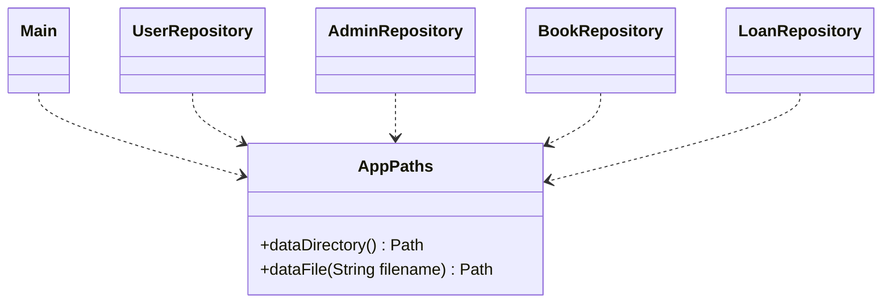

# CP4 경로·배포 설계 변경

## 클래스 다이어그램 반영

`bookstie.util.AppPaths` 추가. 모든 Repository → AppPaths 의존 관계 추가.
Main → AppPaths, 설치 점검용 Repository·StarRatingPanel 의존 관계 추가.
FontManager → 클래스패스 InputStream, StarSvgIcon → 클래스패스 InputStream 사용으로 변경.
기존 FontManager → File 및 StarSvgIcon → 외부 Path 의존 관계 제거.
Repository 모델·서비스 관계와 별점·완독·반납 정책은 동일.

## 함수 명세 반영

| 대상 | 변경 사항 |
| --- | --- |
| AppPaths.dataDirectory() | 명시 절대경로 → JAR 옆 data → 확인된 프로젝트 data 순으로 선택, 실제 경로 캐시. 판별 실패 시 IllegalStateException과 해결 안내 |
| AppPaths.dataFile(String) | 허용된 네 파일명의 절대경로 반환. 잘못된 이름은 IllegalArgumentException |
| Repository 생성자 | 공통 경로 사용. 경로 판별 실패는 IllegalStateException. 기존 파일 보존, 없는 파일만 생성 |
| Repository 읽기/쓰기 | 사용자·관리자·도서도 UTF-8 명시. 기존 탭 구분 필드와 대출 7/8필드 호환 유지 |
| FontManager.getFont(float) | 클래스패스 스트림을 닫고 글꼴 로딩, 실패 원인 stderr 출력 및 기존 기본 글꼴 대체 |
| StarSvgIcon 리소스 로딩 | 클래스패스만 사용, 누락 시 원인이 포함된 IllegalStateException. 작업 디렉터리 폴백 제거 |
| Main.main(String[]) | 시작 전 경로 확인·실패 안내. --check-installation으로 창 없이 데이터 조회·폰트·아이콘 파싱 점검 |

기존 서비스·UI 생성자 명세에도 경로 판별 실패가 전달될 수 있음을 반영.
Main 정상 실행은 기존 Swing 화면 사용. 설치 점검은 데이터에 계정을 추가하지 않으며, 없는 txt만 기존 생성자 정책에 따라 준비.
기존 docs/admin-implementation.md는 과거 구현 기록이며 현재 함수 명세는 소스 Javadoc 및 본 문서를 기준으로 갱신 필요.
보고서에 작업 디렉터리 상대경로 또는 외부 폰트 파일을 전제한 설명이 있으면 위 정책으로 교체.
